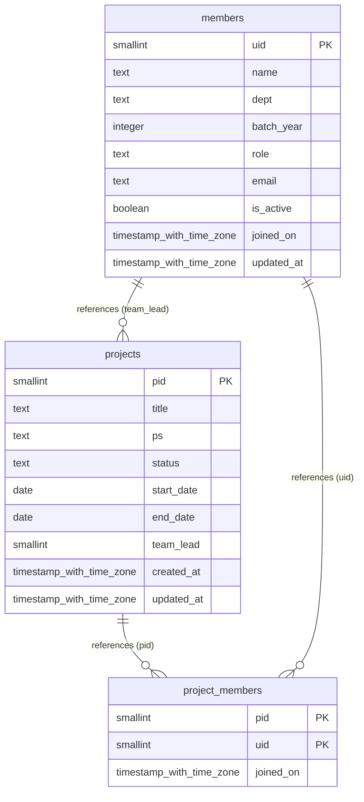

# Database Schema Documentation

> Auto-generated from database schema on `2026-10-19 18:59:48 UTC`.

## Entity Relationship Diagram

---

## Tables Directory

### `members`

| Column | Type | Nullable | Default | Key |
|---|---|---|---|---|
| `uid` | `smallint` | NO | - | PRIMARY KEY |
| `name` | `text` | NO | - | - |
| `dept` | `text` | NO | - | - |
| `batch_year` | `integer` | NO | - | - |
| `role` | `text` | NO | - | - |
| `email` | `text` | NO | - | - |
| `is_active` | `boolean` | NO | `true` | - |
| `joined_on` | `timestamp with time zone` | NO | `now()` | - |
| `updated_at` | `timestamp with time zone` | NO | `now()` | - |

### `project_members`

| Column | Type | Nullable | Default | Key |
|---|---|---|---|---|
| `pid` | `smallint` | NO | - | PRIMARY KEY |
| `uid` | `smallint` | NO | - | PRIMARY KEY |
| `joined_on` | `timestamp with time zone` | NO | `now()` | - |

### `projects`

| Column | Type | Nullable | Default | Key |
|---|---|---|---|---|
| `pid` | `smallint` | NO | - | PRIMARY KEY |
| `title` | `text` | NO | - | - |
| `ps` | `text` | YES | - | - |
| `status` | `text` | NO | `'ongoing'::text` | - |
| `start_date` | `date` | NO | - | - |
| `end_date` | `date` | YES | - | - |
| `team_lead` | `smallint` | YES | - | - |
| `created_at` | `timestamp with time zone` | NO | `now()` | - |
| `updated_at` | `timestamp with time zone` | NO | `now()` | - |

