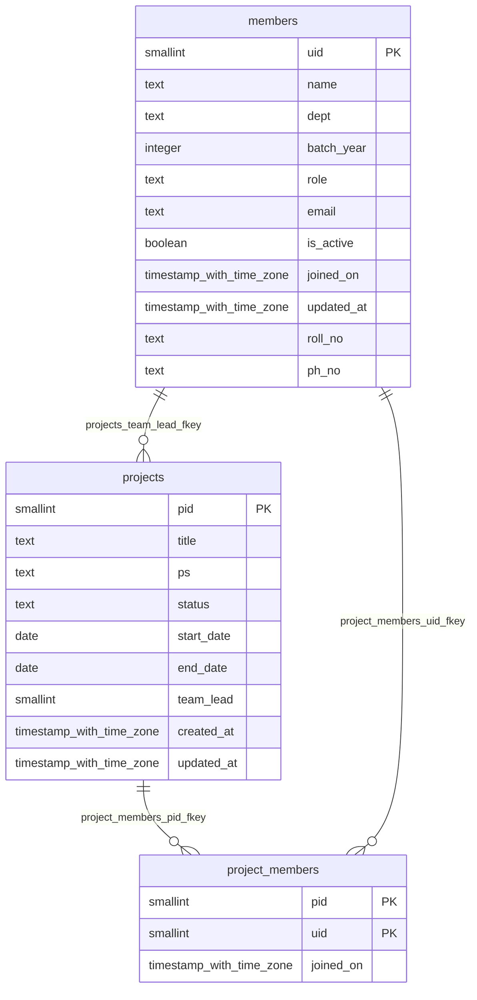

# Database Schema Documentation

> Auto-generated from database schema on `2026-10-21 07:16:42 UTC`.

## Entity Relationship Diagram

---

## Tables Directory

### `members`
> **Description**: People. roll_no is the search key; uid is the internal key.

| Column | Type | Nullable | Default | Key |
|---|---|---|---|---|
| `uid` | `smallint` | NO | - | PRIMARY KEY |
| `name` | `text` | NO | - | - |
| `dept` | `text` | NO | - | - |
| `batch_year` | `integer` | NO | - | - |
| `role` | `text` | NO | - | - |
| `email` | `text` | NO | - | - |
| `is_active` | `boolean` | NO | `true` | - |
| `joined_on` | `timestamp with time zone` | NO | `now()` | - |
| `updated_at` | `timestamp with time zone` | NO | `now()` | - |
| `roll_no` | `text` | NO | - | - |
| `ph_no` | `text` | YES | - | - |

### `project_members`
> **Description**: Assignments. All members of a project share one role.

> **Composite Primary Key**: `(pid, uid)`

**Foreign Key Constraints:**
- `project_members_pid_fkey`: `FOREIGN KEY (pid) REFERENCES projects(pid) ON DELETE CASCADE`
- `project_members_uid_fkey`: `FOREIGN KEY (uid) REFERENCES members(uid) ON DELETE RESTRICT`

| Column | Type | Nullable | Default | Key |
|---|---|---|---|---|
| `pid` | `smallint` | NO | - | PRIMARY KEY |
| `uid` | `smallint` | NO | - | PRIMARY KEY |
| `joined_on` | `timestamp with time zone` | NO | `now()` | - |

### `projects`
> **Description**: Projects. team_lead need not be an assigned member.

**Foreign Key Constraints:**
- `projects_team_lead_fkey`: `FOREIGN KEY (team_lead) REFERENCES members(uid) ON DELETE SET NULL`

| Column | Type | Nullable | Default | Key |
|---|---|---|---|---|
| `pid` | `smallint` | NO | - | PRIMARY KEY |
| `title` | `text` | NO | - | - |
| `ps` | `text` | YES | - | - |
| `status` | `text` | NO | `'ongoing'::text` | - |
| `start_date` | `date` | NO | - | - |
| `end_date` | `date` | YES | - | - |
| `team_lead` | `smallint` | YES | - | - |
| `created_at` | `timestamp with time zone` | NO | `now()` | - |
| `updated_at` | `timestamp with time zone` | NO | `now()` | - |

